# Mobile Laboratory Hub

A centralized React Native laboratory dashboard and master compilation application for current and future mobile computing laboratory activities.

Built with **Expo SDK 58**, **React Native**, **TypeScript**, **Expo Router**, and the **React Context API**. The app runs on Android, iOS, and the web through Expo, with a persistent light/dark theme and a locally stored student display name.


---

## Table of contents

1. [Project overview](#project-overview)
2. [Objectives](#objectives)
3. [Main features](#main-features)
4. [Screens](#screens)
5. [Technology stack](#technology-stack)
6. [Installation requirements](#installation-requirements)
7. [Installation and running](#installation-and-running)
8. [Using Expo Go](#using-expo-go)
9. [Folder structure](#folder-structure)
10. [Global state with React Context](#global-state-with-react-context)
11. [Responsive layout techniques](#responsive-layout-techniques)
12. [Adding future laboratories](#adding-future-laboratories)
13. [Verification performed](#verification-performed)
14. [Screenshots](#screenshots)
15. [Screen recording demonstration guide](#screen-recording-demonstration-guide)
16. [Development team](#development-team)
17. [Academic project information](#academic-project-information)
18. [Demo video](#demo-video)

---

## Project overview

Mobile Laboratory Hub is a single mobile application where a student can access, organize, view, and navigate laboratory activities. It is designed as the final UI requirement and the master compilation application for the course, so future laboratory exercises can be added without redesigning the Home Dashboard.

The application demonstrates:

- Declarative React Native UI design
- Multi-screen navigation with Expo Router
- Reusable, typed components
- React Hooks (`useState`, `useEffect`, `useContext`)
- Responsive Flexbox layouts
- Global state management with the React Context API
- Functional, persisted light and dark themes
- Persistent student profile preferences
- A scalable laboratory registry

No backend, database server, paid API, or external authentication service is used. All data stays on the device with AsyncStorage.

> **Module honesty notice:** Laboratories 1–4 are labeled as **Demo** modules and contain working UI demonstrations. Laboratory 5 (Custom Map and Geofencing) is explicitly labeled **Placeholder** and does **not** request location permissions, read GPS data, or implement geofencing.

---

## Objectives

- Provide one academic hub for all laboratory activities.
- Demonstrate clean React Native and Expo Router architecture.
- Show correct use of local and global React state.
- Demonstrate persistent user preferences and theme switching.
- Build responsive layouts for phones, tablets, and orientation changes.
- Make future laboratory modules easy to register and open.

---

## Main features

- **Home Dashboard** with personalized greeting, current date, avatar, statistics, quick access cards, recent activities, and a settings shortcut.
- **Laboratory Activities** with live search, status badges, activity details, and a registry-driven list.
- **Interactive demonstrations**:
  - `useState` counter (Laboratory 1)
  - Working stack and tab navigation (Laboratory 2)
  - `useEffect` timer with timer/interval cleanup (Laboratory 3)
  - Live responsive metrics using `useWindowDimensions` (Laboratory 4)
  - Explicit geofencing placeholder with no location tracking (Laboratory 5)
- **Student Profile** with editable display name, validation, save feedback, and registered laboratory count.
- **Settings** with a dark/light theme switch, current theme indicator, live palette preview, shortcuts, and a confirmed reset for local preferences.
- **About Application** with version, purpose, technology stack, team placeholders, and academic project details.
- **Global theme updates** across every screen, the tab bar, navigation container, status bar, and reusable components.
- **AsyncStorage persistence** for the theme and display name, with preference restoration on launch and basic storage error handling.
- **Responsive layouts** with safe areas, scrolling, flexible cards, and orientation support.

---

## Screens

| Route | Screen | Purpose |
| --- | --- | --- |
| `/` | Home Dashboard | Greeting, overview, quick access, and recent activities |
| `/activities` | Laboratory Activities | Searchable registry of laboratory modules |
| `/profile` | Student Profile | Edit and persist the student display name |
| `/settings` | Settings | Theme toggle, shortcuts, and preference reset |
| `/about` | About Application | Purpose, stack, team, and academic details |
| `/lab/[id]` | Laboratory Detail | Opens a laboratory demonstration or placeholder |

Navigation uses a bottom tab navigator for Home, Activities, Profile, and Settings, plus stack routes for laboratory details and About.

---

## Technology stack

| Technology | Role |
| --- | --- |
| React Native 0.88 | Native mobile UI |
| Expo SDK 58 | Development and runtime platform |
| TypeScript | Typed application code |
| Expo Router | File-based tab and stack navigation |
| React 19 Hooks | Local state and side effects |
| React Context API | Global theme and profile state |
| AsyncStorage | Persistent theme and profile preferences |
| @expo/vector-icons (Ionicons) | Theme-aware iconography |
| React Native StyleSheet | Component styling |
| Safe Area Context | Notch and system inset handling |
| Expo Status Bar / System UI | Theme-aware system surfaces |

Additional tooling: ESLint with `eslint-config-expo`, TypeScript compiler, Expo Doctor, and Playwright for the optional web smoke test.

---

## Installation requirements

- **Node.js** 20 LTS or newer (tested with Node 24)
- **npm** 10 or newer (tested with npm 11)
- **Expo Go** on a physical Android or iOS device, or an Android/iOS emulator
- A phone and computer on the same network for LAN mode
- Optional: Android Studio for Android emulators
- Optional: Xcode on macOS for iOS simulators

The installed Expo SDK is **58**. Make sure the Expo Go app from the store supports SDK 58.

---

## Installation and running

```bash
# 1. Clone the repository
git clone <your-repository-url>
cd mobile-laboratory-hub

# 2. Install dependencies
npm install

# 3. Start the Expo development server
npm start

# Platform-specific shortcuts
npm run android
npm run ios      # macOS only
npm run web
```

Useful validation commands:

```bash
npm run typecheck   # TypeScript, no emit
npm run lint        # Expo ESLint configuration
npx expo-doctor     # Expo project health checks
npm run export -- --platform web   # Production web bundle
```

If the QR code cannot connect on a restrictive network, use tunnel mode:

```bash
npx expo start --tunnel
```

---

## Using Expo Go

1. Install **Expo Go** on the Android or iOS device.
2. Run `npm start` on the development machine.
3. Scan the QR code:
   - **Android:** scan from inside Expo Go.
   - **iOS:** scan with the Camera app and open the link in Expo Go.
4. Keep the phone and computer on the same Wi-Fi network for LAN mode.
5. If the connection fails, retry with `npx expo start --tunnel`.

---

## Folder structure

```text
MobileLabHub/
├── src/
│   ├── app/
│   │   ├── _layout.tsx              # Root providers, navigation theme, stack
│   │   ├── (tabs)/
│   │   │   ├── _layout.tsx          # Theme-aware bottom tabs
│   │   │   ├── index.tsx            # Home Dashboard
│   │   │   ├── activities.tsx       # Laboratory Activities + search
│   │   │   ├── profile.tsx          # Student Profile
│   │   │   └── settings.tsx         # Settings and reset flow
│   │   ├── about.tsx                # About Application
│   │   ├── +not-found.tsx           # Invalid-route recovery
│   │   └── lab/
│   │       └── [id].tsx             # Laboratory detail route
│   ├── components/
│   │   ├── ActivityCard.tsx
│   │   ├── AppText.tsx
│   │   ├── BrandMark.tsx
│   │   ├── CustomButton.tsx
│   │   ├── DashboardCard.tsx
│   │   ├── EmptyState.tsx
│   │   ├── ProfileAvatar.tsx
│   │   ├── ScreenHeader.tsx
│   │   ├── SearchBar.tsx
│   │   ├── SectionHeader.tsx
│   │   ├── SettingsRow.tsx
│   │   ├── StatCard.tsx
│   │   ├── StatusBadge.tsx
│   │   ├── ThemeToggle.tsx
│   │   └── labs/
│   │       ├── CounterDemo.tsx
│   │       ├── GeofencePlaceholder.tsx
│   │       ├── HooksEffectDemo.tsx
│   │       ├── LabDemoCard.tsx
│   │       ├── NavigationDemo.tsx
│   │       └── ResponsiveDemo.tsx
│   ├── contexts/
│   │   ├── ThemeContext.tsx          # Global theme provider and useTheme hook
│   │   └── ProfileContext.tsx        # Global display name provider
│   ├── constants/
│   │   ├── activities.ts             # Laboratory registry and derived counts
│   │   ├── colors.ts                 # Central light/dark palettes and layout tokens
│   │   └── storage.ts                # AsyncStorage keys and defaults
│   ├── hooks/
│   │   └── useAppTheme.ts            # Re-export of the theme hook
│   ├── types/
│   │   └── index.ts                  # Shared types
│   └── utils/
│       └── storage.ts                # Safe AsyncStorage helpers
├── assets/images/                    # Branded app icon, splash, favicon
├── docs/screenshots/                 # Captured app screenshots
├── app.json                          # Expo configuration
├── eslint.config.js
├── package.json
├── tsconfig.json
└── README.md
```

Expo Router reads routes from `src/app`, which is supported by the SDK 58 template. The root `package.json` entry point remains `expo-router/entry`.

---

## Global state with React Context

Two providers wrap the application in `src/app/_layout.tsx`:

```tsx
<SafeAreaProvider>
  <ThemeProvider>
    <ProfileProvider>
      <AppNavigator />
    </ProfileProvider>
  </ThemeProvider>
</SafeAreaProvider>
```

### ThemeContext

`ThemeContext.tsx` owns the only theme state in the app:

- `mode`: `'light' | 'dark'`
- `colors`: the active centralized palette from `src/constants/colors.ts`
- `isDark`, `isReady`
- `setThemeMode`, `toggleTheme`, `resetTheme`

On launch, the provider restores `@mobilelabhub/theme` from AsyncStorage. When the user flips the switch in Settings:

1. Context state changes immediately.
2. Every component that calls `useTheme()` re-renders with the new palette.
3. The bottom tab bar, stack navigation theme, status bar, and native root background update.
4. The selected mode is written to AsyncStorage.
5. The next launch restores that mode before the app content is shown.

The root layout displays a themed loading screen until the saved theme and profile have been restored, preventing a flash of stale preferences.

No screen defines its own independent theme state.

### ProfileContext

`ProfileContext.tsx` owns the student display name:

- Restores `@mobilelabhub/display-name` on launch.
- Normalizes whitespace and validates empty or overly long names.
- Saves through AsyncStorage before updating global state.
- Exposes `updateDisplayName` and `resetDisplayName`.

Because Home, Profile, and Settings all consume the same context, saving a new name updates the dashboard greeting immediately.

### Consuming the theme

```tsx
import { useTheme } from '@/contexts/ThemeContext';

const { colors, isDark, setThemeMode } = useTheme();
```

Components style themselves from `colors` rather than importing separate light/dark values. This is why theme changes apply consistently across all screens.

---

## Responsive layout techniques

The application uses responsive layout primitives instead of fixed device dimensions:

- `SafeAreaView` from `react-native-safe-area-context` for notches, home indicators, and system bars.
- `ScrollView` for long screens and `FlatList` for the activity registry.
- `useWindowDimensions()` for live width, height, font scale, and orientation metrics.
- Dynamic horizontal padding based on available width.
- A shared maximum content width of 760 px for tablets and the web.
- `flex`, `flexDirection`, `flexWrap`, `flexGrow`, and `flexBasis` for card grids.
- Percentage flex bases with minimum widths so cards wrap from four columns to two to one.
- `minWidth: 0` on flexible text containers to prevent horizontal overflow and text clipping.
- Bottom padding on scroll content so nothing is hidden behind the tab bar.
- `app.json` uses `"orientation": "default"` so portrait and landscape both work.
- The Home dashboard, Activities list, Profile form, Settings cards, About page, and laboratory screens were checked at narrow and landscape widths.

---

## Adding future laboratories

The dashboard is driven entirely by `src/constants/activities.ts`, so new modules do not require Home Dashboard changes.

1. **Add the activity metadata** to `ACTIVITIES`:

   ```ts
   {
     id: 'laboratory-6',
     number: 6,
     title: 'Your Future Laboratory',
     description: 'A short description of the laboratory.',
     status: 'placeholder',       // or 'demonstration' once functional
     demo: 'geofence',            // select or add a demo kind
     icon: 'flask-outline',
     estimatedMinutes: 0,
     tags: ['Planned'],
   }
   ```

2. **Extend the demo union** in `src/types/index.ts` if the module needs a new interactive demonstration:

   ```ts
   export type LabDemo =
     | 'counter'
     | 'navigation'
     | 'hooks'
     | 'responsive'
     | 'geofence'
     | 'your-demo';
   ```

3. **Create the demonstration component** in `src/components/labs/YourDemo.tsx`, using `useTheme()` for colors and existing reusable components where possible.

4. **Register the component** in the `DemonstrationContent` switch in `src/app/lab/[id].tsx`.

5. **Keep placeholder status honest** until the laboratory is actually functional. Use the `placeholder` status and a clear explanation screen.

6. The Home Dashboard totals, recent activities, search results, and activity cards update automatically from the registry.

AsyncStorage keys are defined in one place (`src/constants/storage.ts`) to avoid collisions when adding more persisted preferences.

---

## Verification performed

Verification was run on **November 16, 2026** on Windows with Node 24.21.0 and npm 11.19.0.

| Check | Result |
| --- | --- |
| `npm install` | Passed |
| `npx expo install --check` | Dependencies up to date |
| `npx expo-doctor` | **20/20 checks passed** |
| `npm run typecheck` | Passed with no TypeScript errors |
| `npm run lint` | Passed with no ESLint errors |
| `npx expo export --platform web` | Production bundle and all routes built successfully |
| `npx expo export --platform android` | Android Hermes bundle built successfully |
| `npx expo export --platform ios` | iOS Hermes bundle built successfully |
| Route generation | `/`, `/activities`, `/profile`, `/settings`, `/about`, `/lab/[id]`, `+not-found` |
| Headless Chrome runtime smoke test | Home rendered; tab navigation, search filtering, counter interaction, profile save, theme switching, laboratory detail, and placeholder screen all worked |
| Global theme propagation | Verified on Home, Activities, Settings, and a laboratory detail route |
| Persistence | Display name and dark theme survived a full page reload |
| Responsive widths | Tested at 320 px and 844 × 390 landscape with no horizontal overflow |
| Browser console/page errors | None during the automated flow |

**Not verified in this environment:** native Android and iOS execution in Expo Go or a device emulator was not available. Native-only visuals such as the splash screen, Android adaptive icon mask, and physical-device performance should be confirmed on a real device as part of final submission.

`npm audit --omit=dev` reports three moderate issues in Expo's transitive `minimatch` / `@expo/fingerprint` tooling. The suggested `--force` fix would downgrade Expo to SDK 52 and break the current application, so it was intentionally not applied. Revisit when Expo publishes a compatible upstream update.

Screenshots in `docs/screenshots` were captured from the production web build at a 390 × 844 mobile viewport (2× scale), except the landscape capture at 844 × 390. They document layout and state behavior; they are not represented as native device captures.

---

## Screenshots

### Light mode

<p align="center">
  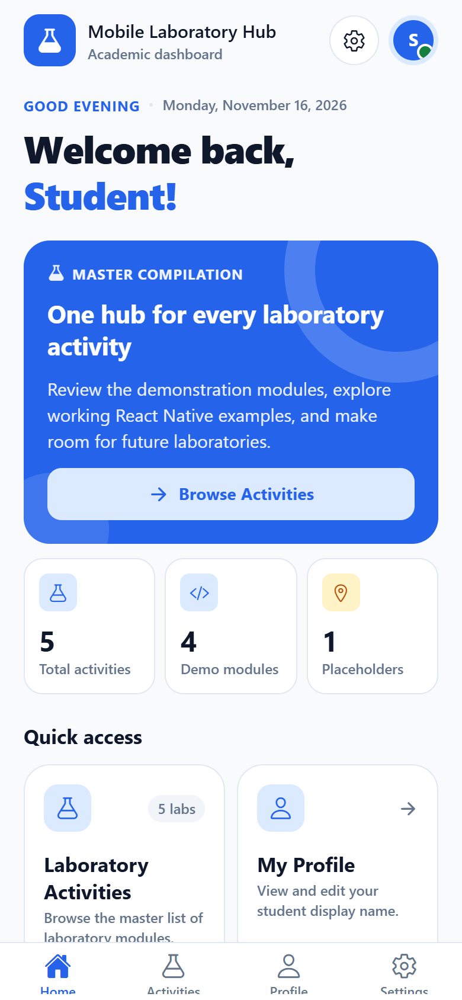
  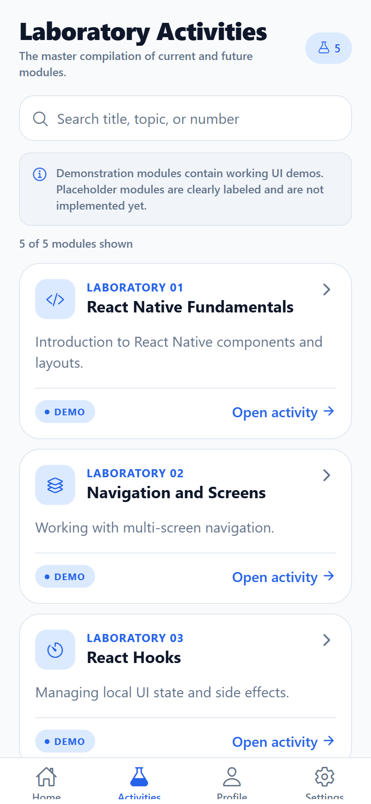
  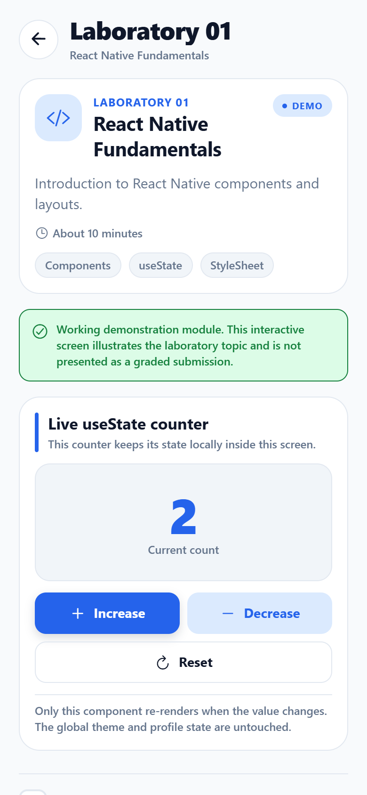
</p>

### Profile, Settings, and About

<p align="center">
  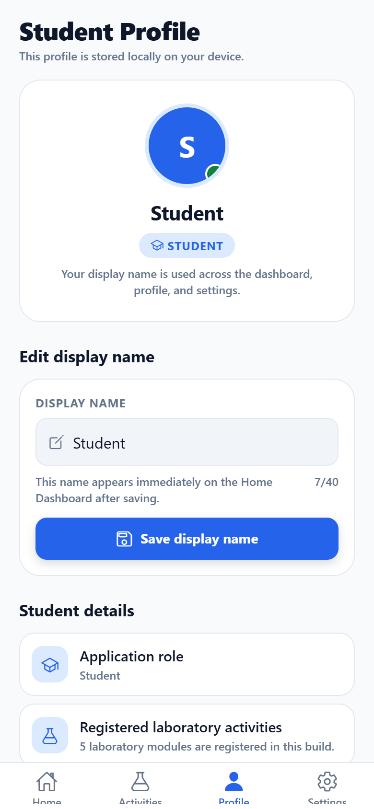
  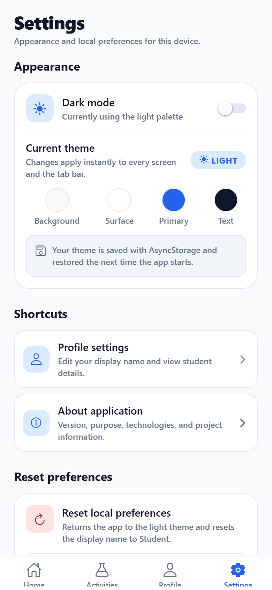
  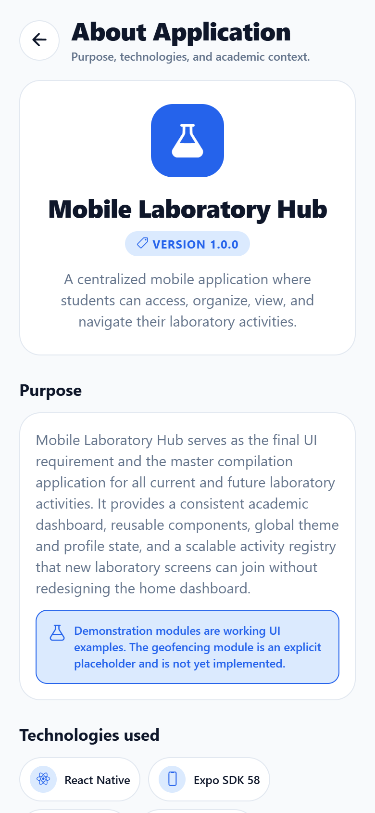
</p>

### Dark mode

<p align="center">
  
  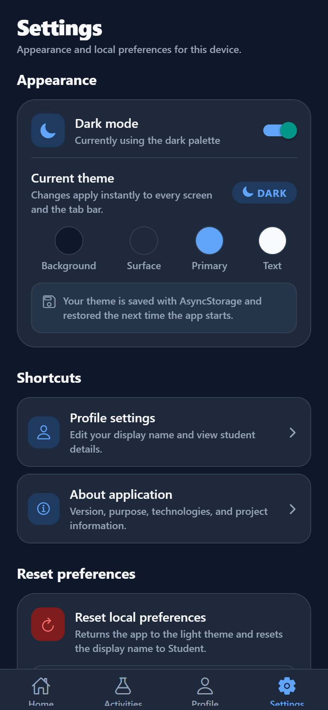
  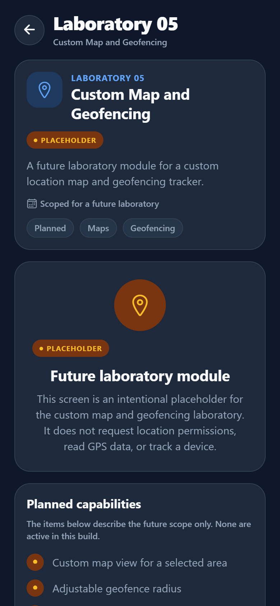
</p>

### Persistence and responsive behavior

<p align="center">
  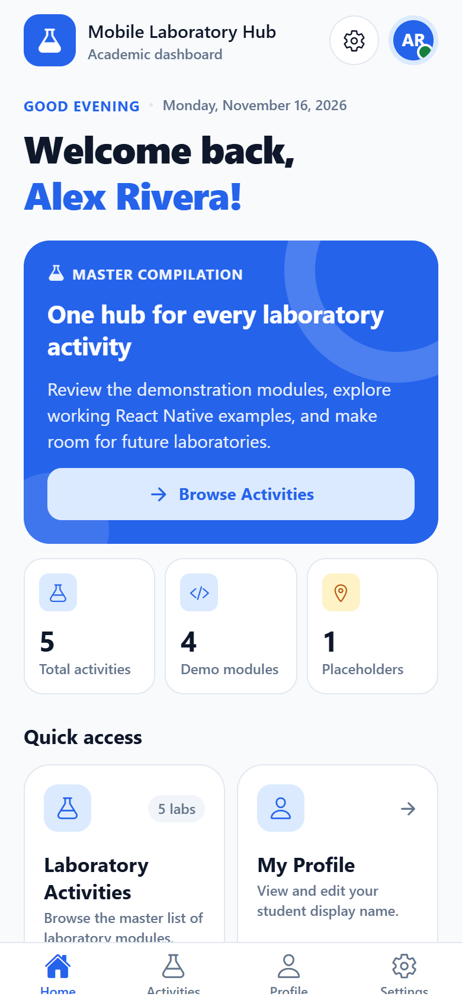
  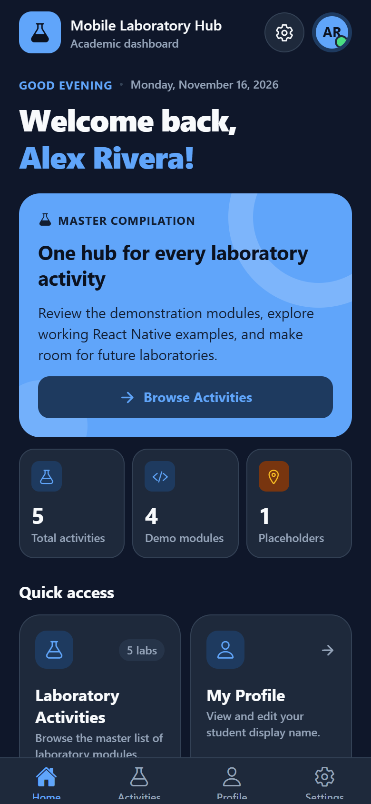
  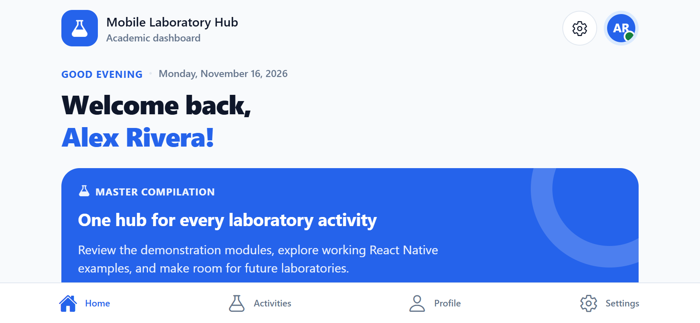
</p>

Additional captures are available in [`docs/screenshots`](docs/screenshots):

- `profile-saved-light.png`
- `activities-dark.png`
- `activities-small-light.png`

To replace these with native captures, run the app in Expo Go and take screenshots in portrait, dark mode, landscape, and after restarting the app.

---

## Screen recording demonstration guide

Record the following sequence for the required demonstration video:

1. Launch **Mobile Laboratory Hub** from Expo Go.
2. Show the **Home Dashboard** in light mode, including the greeting, date, statistics, and navigation cards.
3. Tap the **Activities** tab.
4. Search for a laboratory to demonstrate filtering.
5. Open **Laboratory 1** and demonstrate the `useState` counter.
6. Use the back arrow to return to Activities.
7. Open **Laboratory 3** and show the running `useEffect` timer and its cleanup explanation.
8. Open **Laboratory 5** and state clearly that it is a placeholder with no GPS or geofencing functionality.
9. Navigate to the **Profile** tab.
10. Edit the display name, tap **Save display name**, and show the success message.
11. Return to **Home** and show the updated personalized greeting.
12. Open **Settings** and enable **Dark mode**.
13. Return to **Home** and show the immediate global theme update.
14. Open **Activities** and a laboratory detail screen to confirm dark mode applies there too.
15. Show the theme switch restored to **Light mode** (or leave dark mode enabled for the restart check).
16. Rotate the device or use another device size to show the responsive layout and landscape support.
17. Close the app fully and reopen it in Expo Go to show that the saved theme and display name persist.
18. Optionally demonstrate **Reset preferences** in Settings and explain that it returns the app to light mode with the name `Student`.

Recording tips:

- Android: use the built-in screen recorder or `adb shell screenrecord`.
- iOS: use Screen Recording from Control Center.
- Keep the demonstration between 2 and 4 minutes and show the state transitions clearly.
- If the video is uploaded externally, add the link in the [Demo video](#demo-video) section.

---

## Development team

**Student Pair** — academic project

| Member | Responsibility placeholder |
| --- | --- |
| Student Developer A | UI, navigation, and application architecture |
| Student Developer B | State management, persistence, and laboratory modules |

Replace the names above and in the About screen with the final team member names before submission.

---

## Academic project information

- **Project type:** Master compilation application
- **Academic area:** Mobile computing laboratory
- **Application version:** 1.0.0
- **Platforms:** Android and iOS through Expo; web used for verification
- **Application name:** Mobile Laboratory Hub

This application is the final UI requirement and the master compilation for all current and future laboratory activities. Demonstration modules are working examples for their topics, not claims of graded laboratory completion. The geofencing module remains a placeholder until it is implemented in a future laboratory.

---

## Demo video

**Demo video link:** _Add the final screen recording link here._

Suggested placeholder: `https://your-video-link.example/mobile-laboratory-hub-demo`

---

## License

The scaffolded project includes the MIT license file from the Expo template. Replace it or retain it according to your course and repository requirements.
